# Fase 3 — Documentación de ejecución: migración a MongoDB

**Universidad de San Carlos de Guatemala** · Facultad de Ingeniería · Escuela de Ciencias y Sistemas
**Curso:** Sistemas de Bases de Datos 2 — 2do. Semestre 2026 · **Grupo 4**

---

## 1. Propósito

Este documento cubre el inciso **b)** del enunciado: los scripts usados para crear las colecciones, los índices y cargar los datos, **con la fecha y hora de su ejecución**. Registra una corrida completa de la Fase 3 en una máquina distinta a la de desarrollo. Con eso se comprueba además que la migración es **reproducible**: los conteos y todas las validaciones coinciden con la línea base del repositorio.

El diseño completo, las correcciones y las limitaciones están en el [`README`](../README.md), en [`CAMBIOS_VS_FASE1.md`](../01_correcciones/CAMBIOS_VS_FASE1.md) y en [`LIMITACIONES_CONOCIDAS.md`](../01_correcciones/LIMITACIONES_CONOCIDAS.md). Las capturas de esta corrida están en [`09_evidencias/`](../09_evidencias/) y las bitácoras en [`08_logs/`](../08_logs/).

---

## 2. Entorno de ejecución

| Componente | Versión / valor |
|---|---|
| Sistema operativo | Fedora Linux |
| Docker / Docker Compose | 29.7.2 / 5.5.1 |
| MongoDB | 7 (contenedor `olimpiadas_mongo`, puerto 57017, volumen persistente) |
| PostgreSQL (fuente) | 16 (contenedor `olimpiadas_pg`, puerto 55433) |
| Python | 3.14.7, en entorno virtual `.venv` |
| Librerías | pymongo 4.19.0, psycopg2-binary 2.9.13, pandas 3.1.0, text-unidecode 1.3 |
| `mongosh` | El del contenedor `olimpiadas_mongo`, que `levantar_todo.py` usa cuando no hay uno local |

**Captura 01 — Máquina de ejecución** (fecha, kernel, CPU, memoria y versiones)

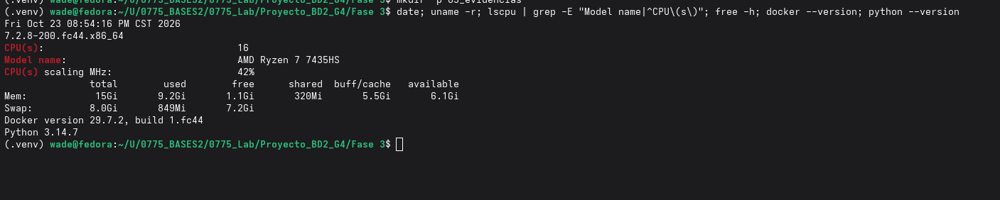

**Captura 02 — Contenedores en ejecución**

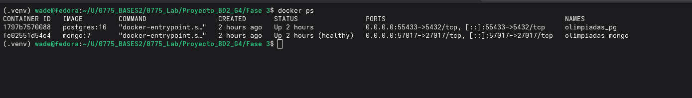

---

## 3. Ejecución de los scripts: orden, fecha y hora

### 3.1 Archivos fuente

La carga a MongoDB parte del dump de PostgreSQL ya corregido, versionado en `00_infraestructura/fuente/olimpiadas_fase3_postgres.dump` (9,193,612 bytes). Ese dump contiene la base de la Fase 1 con las correcciones B1 y B2 aplicadas (sección 8). De él se exportan los archivos `.jsonl` que se cargan a MongoDB.

### 3.2 Comando ejecutado

Todos los pasos se ejecutaron con un solo comando, desde la carpeta `Fase 3/`:

```bash
python levantar_todo.py --recargar
```

`--recargar` fuerza la exportación, la creación de colecciones, la carga, los índices y la validación aunque la base ya tenga datos. El script es idempotente y deja una bitácora con fecha y hora en `08_logs/`.

### 3.3 Cronología

**Corrida documentada: 2026-10-23, inicio 20:57:05, fin 20:57:45 (hora de Guatemala). Duración total: 41 s. Resultado: OK.**

| Paso | Script | Inicio | Fin | Duración | Resultado | Bitácora |
|---|---|---|---|---:|---|---|
| 1 | Verificación de requisitos y `docker compose up -d` | 20:57:05 | 20:57:05 | < 1 s | Docker y librerías OK, MongoDB responde | `levantar_todo_2026-10-23_205705.log` |
| 2 | `02_exportar/exportar_postgres.py` | 20:57:05 | 20:57:22 | 16.9 s | 5 archivos `.jsonl` (≈ 379 MB) | `exportar_postgres_2026-10-23_205705.log` |
| 3 | `03_colecciones/crear_colecciones.js` | 20:57:23.064 (02:57:23Z) | 20:57:23.646 (02:57:23Z) | 0.6 s | 5 colecciones con validador `$jsonSchema` | `levantar_todo_2026-10-23_205705.log` |
| 4 | `04_carga/cargar.py` | 20:57:23 | 20:57:38 | 14.8 s | 473,379 documentos, 0 rechazados | `cargar_2026-10-23_205723.log` |
| 5 | `05_indices/crear_indices.js` | 20:57:39.214 (02:57:39Z) | 20:57:42.600 (02:57:42Z) | 3.4 s | 13 índices secundarios | `levantar_todo_2026-10-23_205705.log` |
| 6 | `06_validacion/validar.py` | 20:57:42 | 20:57:45 | 2.9 s | Todas las verificaciones OK | `validar_2026-10-23_205742.log` |

> **Nota:** la primera vez que se levantó el entorno en esta máquina (2026-10-23, 18:25), `levantar_todo.py` tardó **350 s**, porque además tuvo que crear el contenedor `olimpiadas_pg` y restaurar el dump de PostgreSQL. La corrida documentada aquí reutiliza ese contenedor, por eso tarda 41 s.

### 3.4 Detalle de cada paso

**Captura 03 — Inicio de la ejecución y verificación de requisitos**

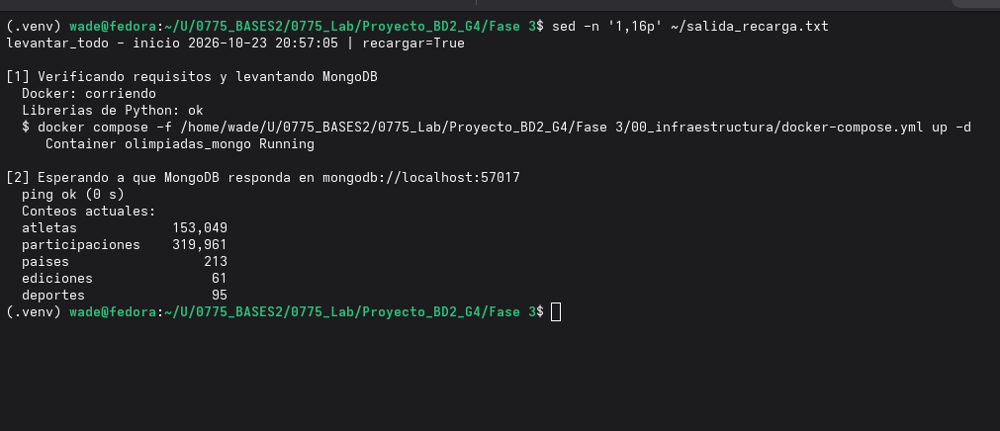

**Paso 2 — Exportación de PostgreSQL a `.jsonl`.** Se exportó en *streaming*, sin cargar todo en memoria. Leyó 204 países, 236 NOC, 61 ediciones, 95 deportes, 153,049 atletas y 394 alias de fusión. Asignó 227 NOC a un país; quedaron 9 entidades sin país (`AIN`, `COK`, `COR`, `EOR`, `IOA`, `ROC`, `ROT`, `TPE`, `UNK`).

| Archivo generado | Tamaño |
|---|---:|
| `atletas.jsonl` | 224.1 MB |
| `participaciones.jsonl` | 153.0 MB |
| `paises.jsonl` | 1.8 MB |
| `ediciones.jsonl` | < 0.1 MB |
| `deportes.jsonl` | < 0.1 MB |

**Captura 04 — Exportación**

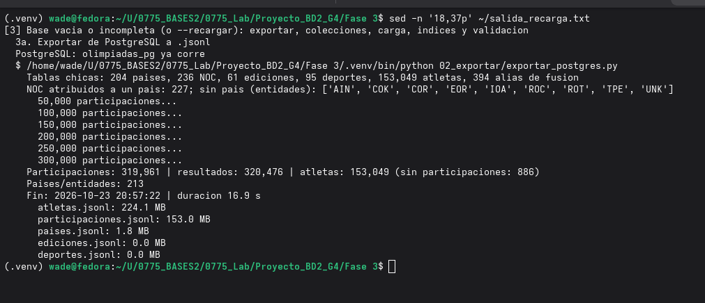

**Paso 3 — Creación de colecciones.** Se crearon `atletas`, `participaciones`, `paises`, `ediciones` y `deportes`, cada una con un validador `$jsonSchema` que exige los campos y tipos del modelo.

**Captura 05 — Creación de colecciones**

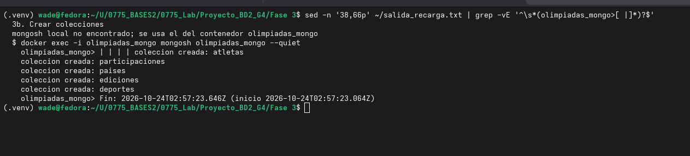

**Paso 4 — Carga.** La carga se hizo en lotes de 5,000 documentos con `insert_many(ordered=False)`.

| Colección | Documentos cargados | Rechazados por el validador | Tiempo |
|---|---:|---:|---:|
| `deportes` | 95 | 0 | 0.0 s |
| `ediciones` | 61 | 0 | 0.0 s |
| `paises` | 213 | 0 | 0.0 s |
| `participaciones` | 319,961 | 0 | 6.0 s |
| `atletas` | 153,049 | 0 | 8.7 s |
| **Total** | **473,379** | **0** | **14.8 s** |

**Captura 06 — Carga de datos**

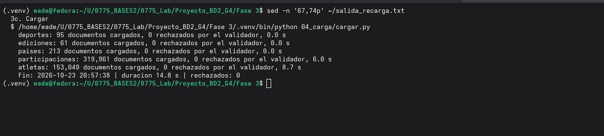

**Paso 5 — Índices.** Se crean después de la carga, porque construir cada índice una sola vez es más rápido que actualizarlo en cada inserción. El detalle está en la sección 5.

**Captura 07 — Creación de índices**

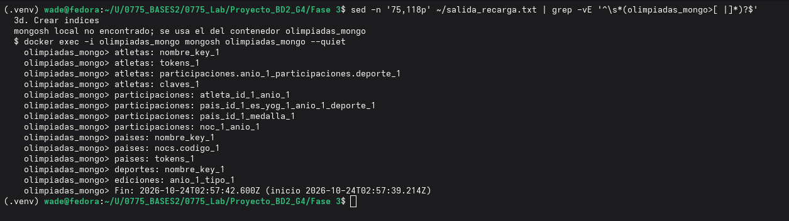

**Paso 6 — Validación.** Resultados en la sección 6.

**Captura 08 — Validación y conteos finales**

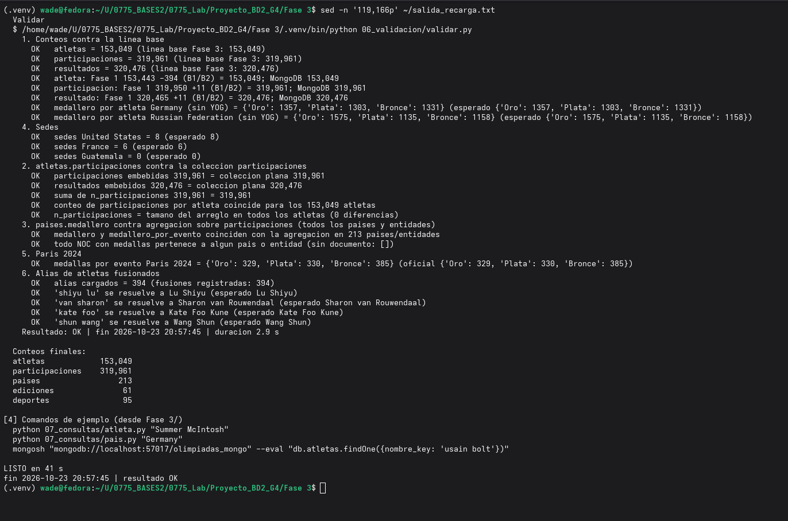

---

## 4. Modelo en MongoDB

El modelo se diseñó **a partir de las dos consultas del enunciado** y no copiando las tablas relacionales. Así cada consulta se resuelve con lecturas indexadas de pocos documentos, sin `$lookup` ni agregaciones al momento de consultar.

| Colección | Documentos | Contenido | Consulta a la que sirve |
|---|---:|---|---|
| `atletas` | 153,049 | Un documento por atleta con sus participaciones y resultados **embebidos**, alias, `claves`, `tokens` y `resumen_medallas` | Consulta por atleta (c): una sola lectura trae todo |
| `participaciones` | 319,961 | Colección plana: una participación por documento, con los datos del atleta desnormalizados, `es_yog` y `pais_id` resuelto con la regla multi-NOC | Consulta por país (d) con filtros por año y deporte, y paginación con `--detalle` |
| `paises` | 213 | 204 países y 9 entidades sin país, con NOC asociados, sedes, medalleros (total, sin YOG, YOG; por atleta y por evento), participación por edición y por deporte **precalculados** | Consulta por país (d): resumen en una lectura |
| `ediciones` | 61 | Catálogo de Juegos (año, tipo, sede) | Catálogo |
| `deportes` | 95 | Catálogo de deportes | Catálogo |

**Decisiones de diseño:**

- **Embeber en `atletas`.** Un atleta tiene a lo sumo algunas decenas de participaciones, muy lejos del límite de 16 MB por documento. Embeberlas evita juntar 5 o 6 tablas como en PostgreSQL.
- **Colección plana `participaciones`.** Un país puede tener decenas de miles de participaciones (Alemania tiene 17,773), así que no conviene embeberlas en `paises`. La colección plana permite filtrar y paginar con un índice compuesto.
- **Duplicación controlada.** Las participaciones aparecen embebidas en `atletas` y en la colección plana. Se acepta a cambio de lecturas rápidas: los datos son históricos y no se actualizan, y `validar.py` comprueba que ambas copias coinciden.
- **Valores precalculados.** Medalleros y resúmenes por país se calculan en la exportación, no en cada consulta.
- **Dos cifras de medallas.** *Por atleta* cuenta una medalla por atleta y resultado (criterio de la Fase 1). *Por evento* cuenta una por evento y NOC, que es el conteo oficial.
- **Regla multi-NOC.** Un país agrupa todos sus NOC históricos; por ejemplo, Alemania incluye `GER`, `FRG`, `GDR` y `SAA`, y `URS`/`EUN` se atribuyen a Rusia, igual que en la Fase 1.
- **Juegos Olímpicos de la Juventud (YOG).** Se excluyen por defecto y se incluyen con `--incluir-yog`.

**Captura 09 — Colecciones y número de documentos en MongoDB**

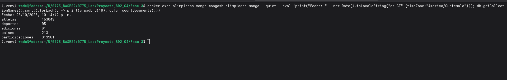

**Captura 11 — Documento de ejemplo de `atletas`** (Usain Bolt, con las participaciones embebidas; se muestran 2)

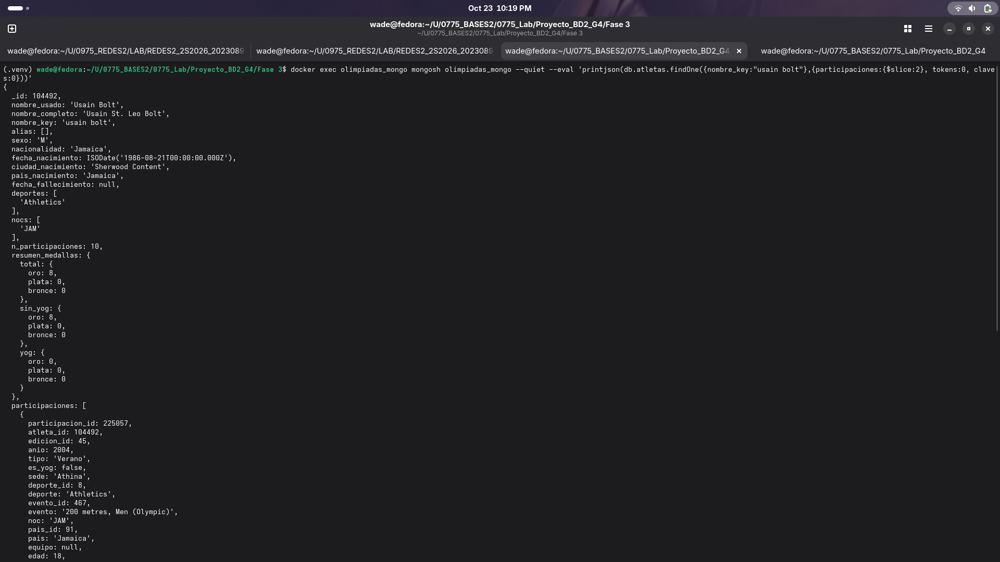

---

## 5. Índices

| Colección | Índice | Uso |
|---|---|---|
| `atletas` | `{nombre_key: 1}` | Búsqueda exacta y por prefijo del nombre plegado (minúsculas, sin acentos). El prefijo es una regex anclada sin la opción `i`, así que usa el índice |
| `atletas` | `{tokens: 1}` | Índice *multikey* sobre las palabras del nombre: encuentra "bolt usain" en cualquier orden |
| `atletas` | `{participaciones.anio: 1, participaciones.deporte: 1}` | Filtros por año y deporte sobre las participaciones embebidas |
| `atletas` | `{claves: 1}` | Búsqueda exacta por nombre usado, nombre completo o **alias** de atletas fusionados |
| `participaciones` | `{atleta_id: 1, anio: 1}` | Participaciones de un atleta, ordenadas por año |
| `participaciones` | `{pais_id: 1, es_yog: 1, anio: 1, deporte: 1}` | Consulta por país con filtros; los campos de igualdad van primero |
| `participaciones` | `{pais_id: 1, medalla: 1}` | Medallas de un país |
| `participaciones` | `{noc: 1, anio: 1}` | Participaciones por código NOC y año |
| `paises` | `{nombre_key: 1}` (único) | Búsqueda del país por nombre |
| `paises` | `{nocs.codigo: 1}` | Búsqueda por código NOC (`GER`, `GUA`) |
| `paises` | `{tokens: 1}` | Búsqueda por palabras o prefijo del nombre |
| `deportes` | `{nombre_key: 1}` | Resolución del filtro `--deporte` |
| `ediciones` | `{anio: 1, tipo: 1}` | Resolución de la edición por año y tipo |

No se usa índice de texto: las búsquedas se resuelven con `nombre_key`, `tokens` y `claves`.

**Captura 10 — Índices en MongoDB**

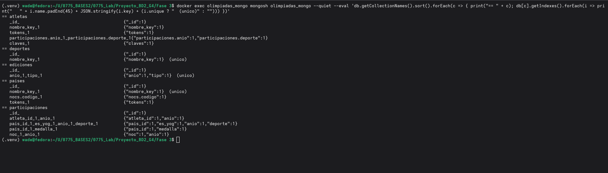

---

## 6. Validación

`validar.py` compara MongoDB contra la línea base de PostgreSQL y verifica la consistencia interna. **Todas las verificaciones dieron OK** (fin 20:57:45, 2.9 s).

| # | Verificación | Resultado |
|---|---|---|
| 1 | Conteos contra la línea base | atletas 153,049 · participaciones 319,961 · resultados 320,476 |
| 1 | Conciliación con la Fase 1 | atletas 153,443 − 394 fusionados = 153,049 · participaciones 319,950 + 11 = 319,961 · resultados 320,465 + 11 = 320,476 |
| 1 | Medallero por atleta, sin YOG | Germany 1,357 / 1,303 / 1,331 · Russian Federation 1,575 / 1,135 / 1,158 |
| 2 | Participaciones embebidas = colección plana | 319,961 = 319,961; resultados 320,476 = 320,476; 0 diferencias por atleta |
| 3 | Medalleros precalculados = agregación sobre `participaciones` | Coinciden en los 213 países y entidades; ningún NOC con medallas queda sin país o entidad |
| 4 | Sedes | United States 8 · France 6 · Guatemala 0 |
| 5 | París 2024, medallas por evento | 329 / 330 / 385, igual al medallero oficial |
| 6 | Alias de atletas fusionados | 394 alias; "shiyu lu" → Lu Shiyu, "van sharon" → Sharon van Rouwendaal, "kate foo" → Kate Foo Kune, "shun wang" → Wang Shun |

---

## 7. Consultas (incisos c y d)

### 7.1 Uso

```bash
python 07_consultas/atleta.py "<nombre>" [--deporte X] [--pais X] [--anio N] [--incluir-yog] [--id N] [--explain]
python 07_consultas/pais.py   "<pais>"   [--anio N] [--deporte X] [--incluir-yog] [--detalle] [--pagina N] [--tam N] [--explain]
```

- **`atleta.py`** busca sin importar acentos ni mayúsculas por nombre, nombre completo o alias; luego por palabras en cualquier orden y luego por prefijo. Tiene tres modos: `DETALLE` (un atleta), `CANDIDATO` (varios homónimos; se elige con `--id` o se acota con `--pais`, `--deporte` o `--anio`) y `SIN_COINCIDENCIAS`.
- **`pais.py`** acepta el nombre en inglés, el código NOC o un prefijo. Muestra los NOC asociados, las sedes con año, tipo y ciudad (o `NUNCA_SEDE`), los medalleros, la participación por edición y por deporte. Con `--detalle` pagina las participaciones y sus resultados.
- Las dos imprimen la fecha y hora de ejecución y el tiempo de respuesta en milisegundos.

### 7.2 Resultados de esta corrida (2026-10-23, 22:53)

| # | Consulta | Modo / resultado | Tiempo MongoDB | Tiempo total |
|---|---|---|---:|---:|
| 12 | `atleta.py "Summer McIntosh"` | DETALLE: 11 participaciones, 3 oros y 1 plata; aparece su alias de la fuente 3 | 1.3 ms | 1.5 ms |
| 13 | `atleta.py "michael phelps" --anio 2008` | DETALLE filtrado: 8 participaciones, 8 oros (Beijing 2008) | 1.6 ms | 1.8 ms |
| 14 | `atleta.py "wang" --pais China --deporte Swimming --anio 2024` | CANDIDATO: 4 atletas; Wang Shun (1/0/2) con su alias "Shun Wang" | 5.6 ms | 5.8 ms |
| 15 | `atleta.py "Usain Bolt" --explain` | DETALLE: 10 participaciones, 8 oros; plan `IXSCAN(claves_1)` y luego `IDHACK` | 1.3 ms | 2.4 ms |
| 16 | `pais.py "Guatemala"` | `NUNCA_SEDE`; 17 ediciones, 479 participaciones, 264 atletas; medallas 1 / 1 / 1 | 0.9 ms | 1.2 ms |
| 17 | `pais.py "Germany" --anio 2024` | Sedes 1936 Invierno (Garmisch-Partenkirchen), 1936 Verano (Berlin), 1972 Verano (Munich); 2024: por evento 12 / 13 / 8 | 1.8 ms | 2.0 ms |
| 18 | `pais.py "Germany" --explain` | 49 ediciones, 17,773 participaciones; por evento 615 / 622 / 615; plan `IXSCAN(nombre_key_1)` | 1.7 ms | 2.6 ms |

**Todas las consultas responden en menos de 6 ms en MongoDB.** Los planes de ejecución confirman que se usan los índices (`IXSCAN` o `IDHACK`, nunca `COLLSCAN`). En cada caso el servidor examinó 1 índice y 1 documento para devolver 1 resultado.

### 7.3 Consulta por atleta

**Captura 12 — Detalle de un atleta**

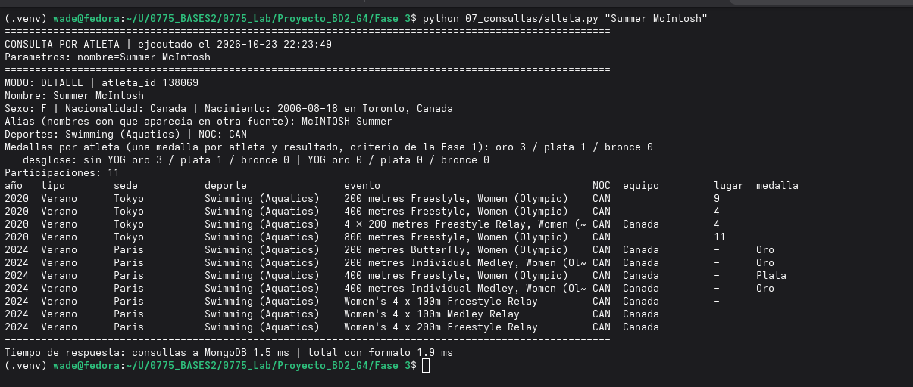

**Captura 13 — Filtro por año**

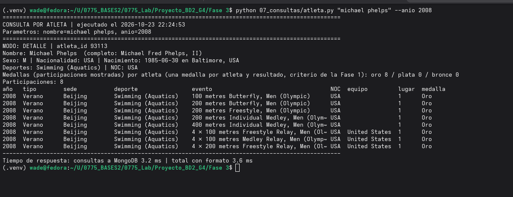

**Captura 14 — Homónimos acotados con filtros**

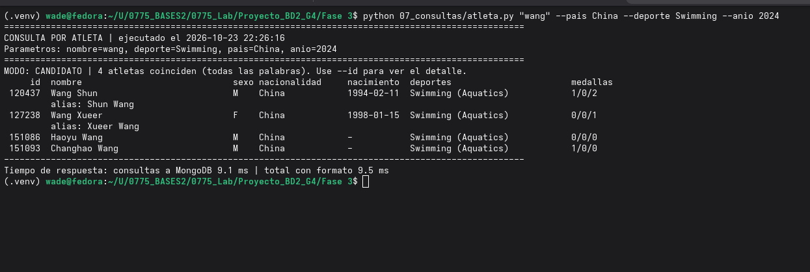

**Captura 15 — Plan de ejecución**

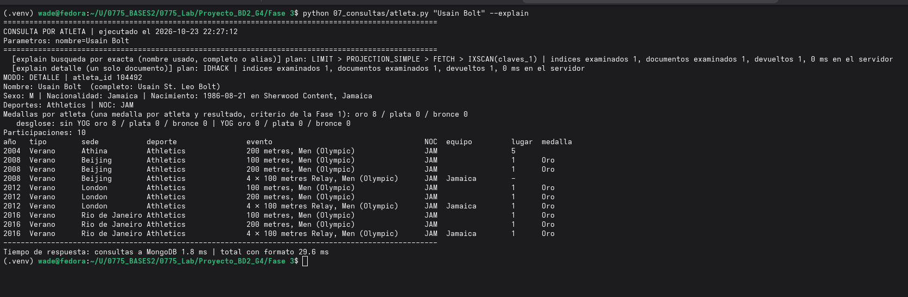

### 7.4 Consulta por país

**Captura 16 — Resumen de un país que nunca ha sido sede**

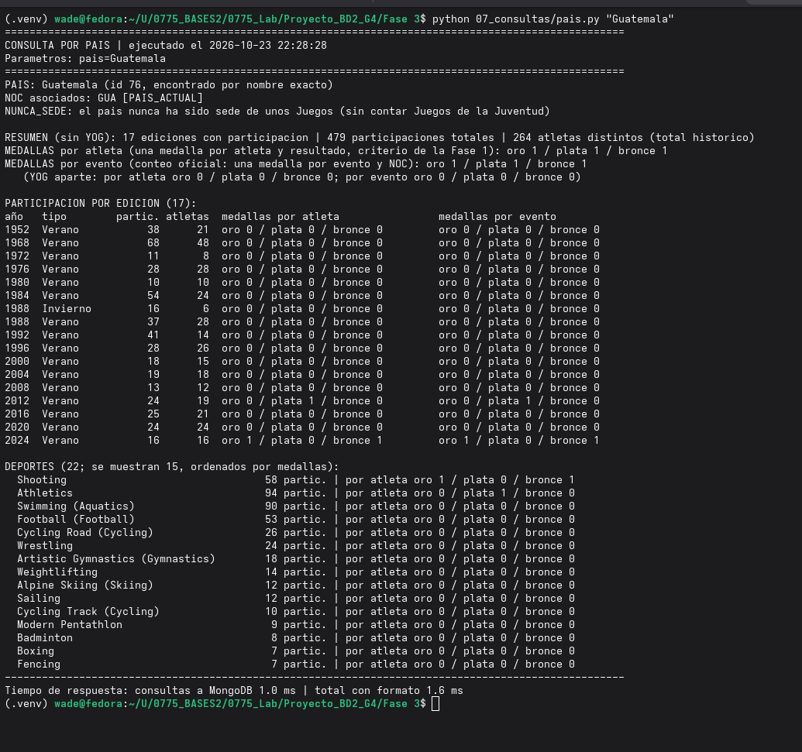

**Captura 17 — Sedes y filtro por año**

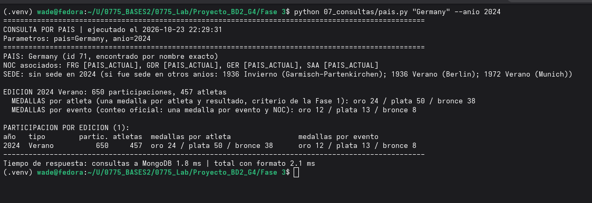

**Captura 18 — Plan de ejecución**

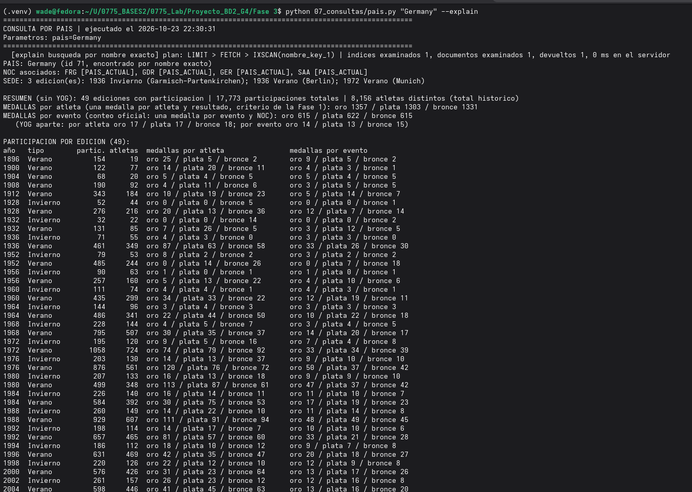

### 7.5 Notas para interpretar los resultados

- **Medallas por atleta y por evento.** En deportes de equipo cada integrante suma una medalla "por atleta"; por eso Alemania en 2024 tiene 24 / 50 / 38 por atleta y 12 / 13 / 8 por evento. La cifra comparable con el medallero oficial es la de **por evento**.
- **Bolt, relevo 4×100 de 2008, sin medalla.** El COI retiró ese oro a Jamaica en 2017; por eso Bolt tiene 8 oros.
- **París 2024 sin lugar y con otro estilo de nombre de evento.** La fuente 3 trae medallas pero no posiciones, y sus nombres de evento ("Women's 4 x 100m Medley Relay") difieren de los de la fuente 1. Está documentado en las limitaciones.
- **Atletas sin fecha de nacimiento y nombre en orden occidental** (por ejemplo "Haoyu Wang"). Solo existen en la fuente 3 (2024).

---

## 8. Correcciones respecto a la Fase 1 (inciso a)

| Corrección | Qué se corrigió | Efecto |
|---|---|---|
| **B1** | Medallas faltantes de París 2024 (incluye el relevo mixto de triatlón), contrastadas con el medallero oficial | +11 participaciones y +11 resultados; París 2024 por evento = 329 / 330 / 385 |
| **B2** | Atletas duplicados entre fuentes, con bitácora y auditoría por muestreo contra Wikipedia | 394 fusiones (153,443 → 153,049); el nombre anterior queda como alias y sigue encontrando al atleta |

| Dato | Fase 1 | Fase 3 |
|---|---:|---:|
| Atletas | 153,443 | 153,049 |
| Participaciones | 319,950 | 319,961 |
| Resultados | 320,465 | 320,476 |
| Alemania, oro / plata / bronce (por atleta) | 1,354 / 1,302 / 1,331 | 1,357 / 1,303 / 1,331 |

Los scripts de corrección están en `01_correcciones/` (`B1_medallas_paris2024.sql`, `B2_fusion_atletas.sql`) con sus CSV de datos, y sus bitácoras en `08_logs/`. El detalle de antes y después está en [`CAMBIOS_VS_FASE1.md`](../01_correcciones/CAMBIOS_VS_FASE1.md).

---

## 9. Limitaciones conocidas (resumen)

- 199 eventos exclusivos de 2024 conservan la nomenclatura de la fuente 3.
- 66 pares de duplicados probables sin fusionar (48 de deportes de equipo grandes, 12 no verificables, 4 verificados como incorrectos y 2 de otros motivos).
- 178 atletas de la fuente 3 con nombre "partícula + nombre de pila", sin apellido recuperable.
- Lasse Lührs (relevo mixto de triatlón, Alemania) no existe en la base; las medallas por evento sí coinciden.
- 886 atletas sin participaciones, heredados de la Fase 1.

Detalle y conteos en [`LIMITACIONES_CONOCIDAS.md`](../01_correcciones/LIMITACIONES_CONOCIDAS.md).

---

## 10. Cómo reproducir esta ejecución

Desde un clon del repositorio, con Docker en ejecución:

```bash
cd "Fase 3"
python3 -m venv .venv
source .venv/bin/activate
pip install -r requirements.txt
python levantar_todo.py              # primera vez: crea Postgres desde el dump, exporta, carga y valida
python levantar_todo.py --recargar   # rehace exportación, colecciones, carga e índices
python 07_consultas/atleta.py "Summer McIntosh"
python 07_consultas/pais.py "Guatemala"
```

Si no hay `mongosh` instalado, se puede usar el del contenedor:

```bash
docker exec -it olimpiadas_mongo mongosh olimpiadas_mongo
```

---

## Anexo A — Evidencias

| # | Archivo | Contenido |
|---|---|---|
| 01 | `fase3_pb_01_maquina.png` | Máquina de ejecución y versiones |
| 02 | `fase3_pb_02_contenedores.png` | Contenedores `olimpiadas_mongo` y `olimpiadas_pg` |
| 03 | `fase3_pb_03_inicio_carga.png` | Inicio de `levantar_todo.py --recargar` |
| 04 | `fase3_pb_04_exportacion.png` | Exportación de PostgreSQL a `.jsonl` |
| 05 | `fase3_pb_05_colecciones.png` | Creación de colecciones |
| 06 | `fase3_pb_06_carga.png` | Carga por lotes |
| 07 | `fase3_pb_07_indices.png` | Creación de índices |
| 08 | `fase3_pb_08_validacion.png` | Validación y conteos finales |
| 09 | `fase3_pb_09_conteos_mongo.png` | Colecciones y documentos en MongoDB |
| 10 | `fase3_pb_10_indices_mongo.png` | Índices en MongoDB |
| 11 | `fase3_pb_11_documento_ejemplo.png` | Documento de ejemplo de `atletas` |
| 12 | `fase3_pb_12_atleta_detalle.png` | Consulta por atleta: detalle |
| 13 | `fase3_pb_13_atleta_filtros.png` | Consulta por atleta: filtro por año |
| 14 | `fase3_pb_14_atleta_candidatos.png` | Consulta por atleta: homónimos con filtros |
| 15 | `fase3_pb_15_atleta_explain.png` | Consulta por atleta: plan de ejecución |
| 16 | `fase3_pb_16_pais_resumen.png` | Consulta por país: resumen |
| 17 | `fase3_pb_17_pais_sedes_filtros.png` | Consulta por país: sedes y filtro por año |
| 18 | `fase3_pb_18_pais_explain.png` | Consulta por país: plan de ejecución |

## Anexo B — Bitácoras de esta corrida (`08_logs/`)

| Archivo | Contenido |
|---|---|
| `levantar_todo_2026-10-23_205705.log` | Corrida completa documentada (41 s) |
| `exportar_postgres_2026-10-23_205705.log` | Exportación a `.jsonl` |
| `cargar_2026-10-23_205723.log` | Carga por lotes |
| `validar_2026-10-23_205742.log` | Validación |
| `levantar_todo_2026-10-23_182533.log` | Primera puesta en marcha en esta máquina (350 s, con restauración de PostgreSQL) |